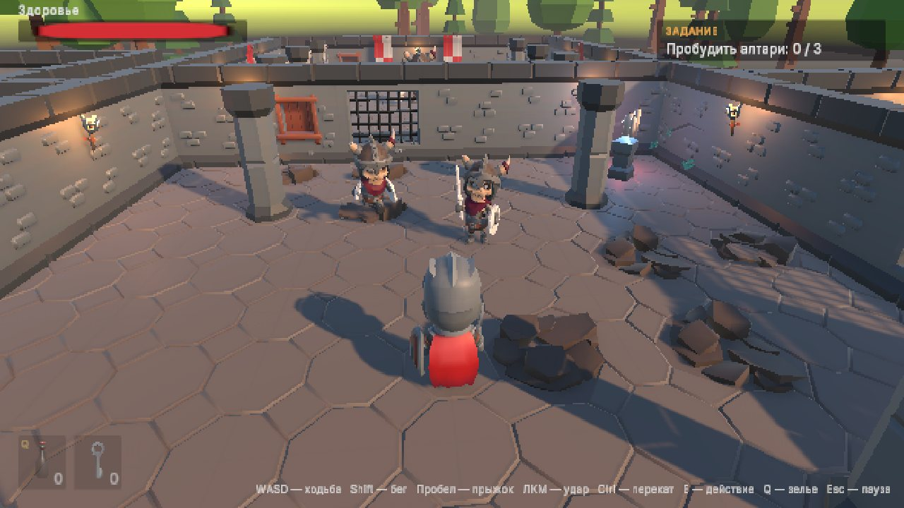

# Unity 6: From Your First Game to Release — book projects

[Русская версия](README.md)

Two complete Unity 6 (URP) games from Maksim Boiko's book **«Unity 6: от первой игры до публикации»** (in Russian): full source code, scenes, assets and ready-to-run builds. The code matches the book listings line by line.

| | Crystal Collector | Ruins |
|---|---|---|
| Genre | physics arcade | third-person action-adventure |
| Book chapter | 10 | 27–28 |
| Play in browser | [▶ play](https://livelypuer.github.io/unity6-book-projects/crystal-collector/) | [▶ play](https://livelypuer.github.io/unity6-book-projects/ruins/) |
| Download | [Releases](https://github.com/LivelyPuer/unity6-book-projects/releases) | [Releases](https://github.com/LivelyPuer/unity6-book-projects/releases) |

## Crystal Collector


Roll a ball across floating islands and collect every crystal before time runs out, without falling off or getting hit by spiked balls. Small but complete: main menu, level, timer, win and lose screens, pause, sound and music, particles and post-processing.

**Controls:** WASD — roll, Space — jump, Esc — pause.

## Ruins



A knight explores ancient ruins, fights skeletons, finds a key, pulls a lever, awakens three altars and defeats the guardian — a two-phase boss with clearly telegraphed vulnerability windows. Combat has weight: blade trail during active frames, sparks, hit stop, camera shake and impact sounds. Shrines save the game and become respawn points.

**Controls:** WASD — move, Shift — sprint, Space — jump, LMB — attack (up to a 3-hit combo), Ctrl — roll, E — interact, Q — potion, Esc — pause. Gamepad supported.

What's inside `Ruins/Assets/_Project`:

| Folder | Contents |
|---|---|
| `Player` | input, Character Controller movement, combo combat, animation, potions, respawn |
| `Combat` | health, attack tokens (enemies take turns instead of swarming) |
| `Enemies` | skeleton state machine, vision, enemy hitbox, phased boss, arena |
| `Interaction`, `Items`, `Quests` | interaction, items and inventory, doors, lever, altars, shrines, quest |
| `Save` | save system with version migrations, player save, level start |
| `Audio`, `UI` | sounds, adaptive combat music, HUD, popups, pause menu |
| `Core` | shared interfaces, state machine, save IDs |
| `Editor` | save ID validator, build menu and command-line builds |
| `Tests` | EditMode and PlayMode tests |

## How to open

1. Install **Unity 6.3 LTS** (6000.3.26f1 or newer from the 6000.3 branch) via Unity Hub. Add Windows / Mac / Web Build Support modules if you want to build.
2. Clone the repository:
   ```bash
   git clone https://github.com/LivelyPuer/unity6-book-projects.git
   ```
3. In Unity Hub choose **Add → Add project from disk** and pick the `CrystalCollector` or `Ruins` folder. The first import takes a few minutes.
4. Open `Assets/_Project/Scenes/MainMenu` (Crystal Collector) or `Assets/_Project/Scenes/Ruins` and press **Play**.

Command-line build (script from chapter 32):

```bash
Unity -batchmode -quit -projectPath Ruins -executeMethod BuildScript.BuildWeb
```

Methods: `BuildWindows`, `BuildMac`, `BuildWeb`; output goes to the project's `Builds` folder. Build the web version **first** (or delete `Library/ShaderCache` before it): after desktop builds, the shader cache breaks the web build.

> **macOS builds** are not signed. On first launch, right-click the app and choose **Open**.

## The book

**Maksim Boiko. «Unity 6: от первой игры до публикации»** (Russian, 623 pages). A complete hands-on guide: the editor and C# from scratch, physics, URP graphics and shaders, animation (from Mecanim to procedural), design patterns, AI, saves, optimization, testing, builds and publishing to Steam, Google Play, RuStore and itch.io. Available as an e-book on [LitRes](https://www.litres.ru/book/maksim-boiko-34103572/unity-6-ot-pervoi-igry-do-publikatsii-74614187/).

## Licenses

- **Code** — MIT (see [LICENSE](LICENSE)), free for any use, including commercial.
- **KayKit models** (Adventurers, Skeletons, Dungeon Remastered) — [Kay Lousberg](https://kaylousberg.com/), CC0.
- **Kenney models** (Platformer Kit, Nature Kit) — [Kenney](https://kenney.nl/), CC0.
- **Inter font** — SIL Open Font License.
- **Sounds and music** were synthesized for these projects and ship with the code.

Third-party asset licenses live next to the assets in `Assets/ThirdParty`.
