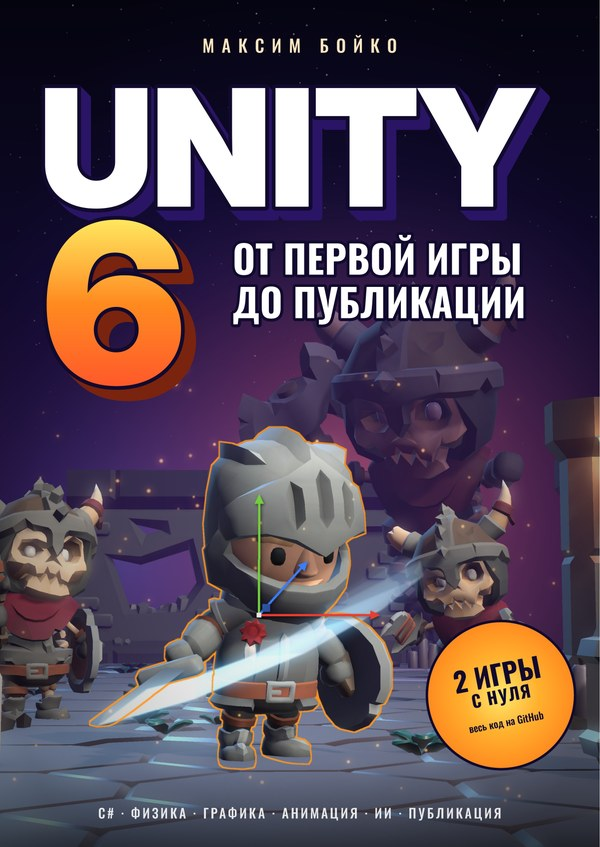
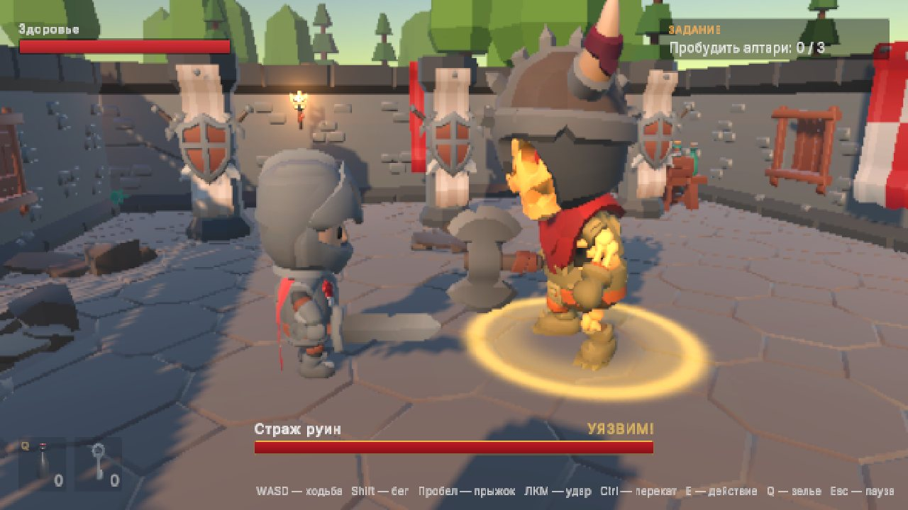
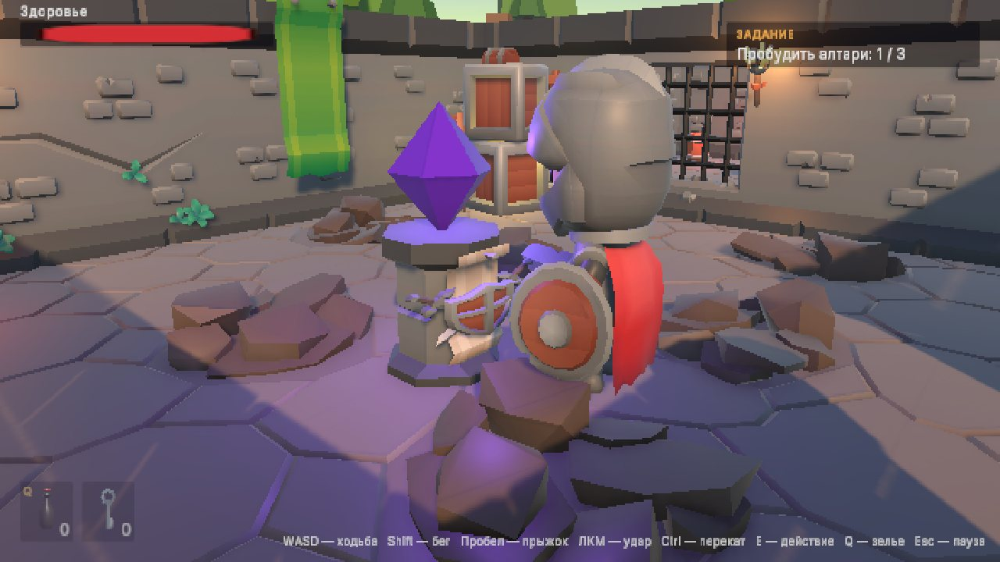

# Unity 6: от первой игры до публикации — проекты книги

[English version](README.en.md)

Две игры из книги **Максима Бойко «Unity 6: от первой игры до публикации»**: полный исходный код, сцены, ассеты и готовые сборки. Код в репозитории совпадает с листингами книги — если что-то не получается, сравните свой проект с готовым.

<p align="center">
  <a href="https://www.litres.ru/book/maksim-boiko-34103572/unity-6-ot-pervoi-igry-do-publikatsii-74614187/"></a>
  <br>
  <a href="https://www.litres.ru/book/maksim-boiko-34103572/unity-6-ot-pervoi-igry-do-publikatsii-74614187/"></a>
  <a href="https://app.lava.top/products/4a750350-6e4c-41b2-926d-c6e9bb2e4864"></a>
</p>

<p align="center">Автор — Максим Бойко · <a href="https://t.me/gamedev_ulsk">Telegram-канал</a> · <a href="https://t.me/krest_leveosso">Telegram</a> · <a href="mailto:maxkzboiko@gmail.com">почта</a></p>

<p align="center"><b>Собираем на бумажную книгу</b> — цель 1 000 000 ₽. Книга с автографом — 5 000 ₽, поддержать сбор — от 300 ₽: <a href="https://app.lava.top/products/4a750350-6e4c-41b2-926d-c6e9bb2e4864">app.lava.top/maksimboiko</a></p>

| | Кристальный сборщик | Руины |
|---|---|---|
| Жанр | аркада с физикой | экшен-приключение от третьего лица |
| Глава книги | 10 | 27–28 |
| Играть в браузере | [▶ запустить](https://livelypuer.github.io/unity6-book-projects/crystal-collector/) | [▶ запустить](https://livelypuer.github.io/unity6-book-projects/ruins/) |
| Скачать | [Releases](https://github.com/LivelyPuer/unity6-book-projects/releases) | [Releases](https://github.com/LivelyPuer/unity6-book-projects/releases) |

## Кристальный сборщик


Первая игра книги: катите шар по парящим островам и соберите все кристаллы, пока не вышло время, — не свалившись в пропасть и не попав под шипастые шары. Маленькая, но законченная игра: главное меню, уровень, таймер, победа и поражение, пауза, звук и музыка, частицы и постобработка.

**Управление:** WASD — катиться, пробел — прыжок, Esc — пауза.

Что внутри (`CrystalCollector/`):

- `Assets/_Project` — игра: сцены `MainMenu` и `Level01`, скрипты главы 10, префабы, материалы, звуки, эффекты;
- `Assets/BookExamples` — демонстрационные сцены, с которых сняты иллюстрации книги: свет, материалы PBR, постобработка, коллайдеры, интерфейс;
- `Assets/ThirdParty/Kenney` — модели Kenney (Platformer Kit, Nature Kit).

## Руины


Большой проект книги: рыцарь исследует древние руины, сражается со скелетами, находит ключ, тянет рычаг, пробуждает три алтаря и побеждает стража — босса с двумя фазами и явными окнами уязвимости (золотое свечение и надпись «УЯЗВИМ!»). Бой «сочный»: шлейф клинка в активных кадрах, искры, остановка кадра, тряска камеры, звуки ударов. Святилища сохраняют игру и становятся точками возрождения.

| | |
|---|---|
|  |  |

**Управление:** WASD — ходьба, Shift — бег, пробел — прыжок, ЛКМ — удар (до трёх в комбо), Ctrl — перекат, E — действие, Q — зелье, Esc — пауза. Поддерживается геймпад.

Что внутри (`Ruins/Assets/_Project`):

| Папка | Содержимое |
|---|---|
| `Player` | ввод, движение на Character Controller, бой с комбо, анимация, зелья, возрождение |
| `Combat` | здоровье, жетоны атаки |
| `Enemies` | конечный автомат скелета, зрение, хитбокс врага, босс с фазами, арена |
| `Interaction`, `Items`, `Quests` | взаимодействие, предметы и инвентарь, двери, рычаг, алтари, святилища, задание |
| `Save` | система сохранений с миграциями, сохранение героя, старт уровня |
| `Audio`, `UI` | звуки, адаптивная боевая музыка, HUD, всплывающие сообщения, меню паузы |
| `Core` | общие интерфейсы, автомат состояний, ID сохранений |
| `Editor` | проверка ID сохранений, сборка из меню и командной строки |
| `Tests` | тесты EditMode и PlayMode |

## Как открыть

1. Установите **Unity 6.3 LTS** (6000.3.26f1 или новее из ветки 6000.3) через Unity Hub. Для сборок понадобятся модули Windows / Mac / Web Build Support.
2. Клонируйте репозиторий:
   ```bash
   git clone https://github.com/LivelyPuer/unity6-book-projects.git
   ```
3. В Unity Hub нажмите **Add → Add project from disk** и выберите папку `CrystalCollector` или `Ruins`. Первый импорт занимает несколько минут.
4. Откройте сцену `Assets/_Project/Scenes/MainMenu` (Кристальный сборщик) или `Assets/_Project/Scenes/Ruins` и нажмите **Play**.

Сборка из командной строки (скрипт из главы 32):

```bash
Unity -batchmode -quit -projectPath Ruins -executeMethod BuildScript.BuildWeb
```

Методы: `BuildWindows`, `BuildMac`, `BuildWeb`; результат — в папке `Builds` проекта. Веб-версию собирайте **первой** (или удалите перед ней `Library/ShaderCache`): после сборок для Windows и macOS кэш шейдеров ломает веб-сборку — почему, рассказано в главе 28.

> **Сборки для macOS** не подписаны. При первом запуске щёлкните приложение правой кнопкой мыши и выберите **Открыть**.

## Книга

**Максим Бойко. «Unity 6: от первой игры до публикации».** Полное практическое руководство: от интерфейса редактора и C# до физики, графики, анимации (от Mecanim до процедурной), паттернов проектирования, ИИ, оптимизации, сборки и публикации игры. В книге 38 глав, сотни листингов, схемы и разборы известных игр.

<a href="https://www.litres.ru/book/maksim-boiko-34103572/unity-6-ot-pervoi-igry-do-publikatsii-74614187/"></a> <a href="https://app.lava.top/products/4a750350-6e4c-41b2-926d-c6e9bb2e4864"></a>

Электронная книга — [на ЛитРес](https://www.litres.ru/book/maksim-boiko-34103572/unity-6-ot-pervoi-igry-do-publikatsii-74614187/).

**Бумажная книга.** Сейчас собираем на печатное издание, цель 1 000 000 ₽. Можно оформить [предзаказ книги с автографом за 5 000 ₽](https://app.lava.top/products/4a750350-6e4c-41b2-926d-c6e9bb2e4864) или просто поддержать сбор от 300 ₽ — за 1 000 ₽ ваше имя попадёт в благодарности. Если книга пригодилась и хочется увидеть её на бумаге — заходите.

## Об авторе

**Максим Сергеевич Бойко** — основатель издательства игр Devilime, разработчик игр и предприниматель. Организатор всероссийских игровых ивентов и хакатонов по разработке игр — фестиваля [Gameday](https://gameday73.ru/) и хакатона [LimeGames Hack](https://limegames-hack.ru/).

Нашли ошибку, застряли на каком-то шаге или доделали свою первую игру — пишите:

- Telegram-канал GameDev Ulyanovsk — [t.me/gamedev_ulsk](https://t.me/gamedev_ulsk): новости, разборы, анонсы джемов и хакатонов;
- мой Telegram — [t.me/krest_leveosso](https://t.me/krest_leveosso);
- почта — [maxkzboiko@gmail.com](mailto:maxkzboiko@gmail.com).

Ошибку в коде проектов можно сразу завести в [Issues](https://github.com/LivelyPuer/unity6-book-projects/issues).

## Лицензии

- **Код** — MIT (см. [LICENSE](LICENSE)): используйте в своих проектах, в том числе коммерческих.
- **Модели KayKit** (Adventurers, Skeletons, Dungeon Remastered) — [Kay Lousberg](https://kaylousberg.com/), CC0.
- **Модели Kenney** (Platformer Kit, Nature Kit) — [Kenney](https://kenney.nl/), CC0.
- **Шрифт Inter** — SIL Open Font License.
- **Звуки и музыка** синтезированы для этих проектов и распространяются вместе с кодом.

Лицензии сторонних ассетов лежат рядом с ними в папках `Assets/ThirdParty`.
